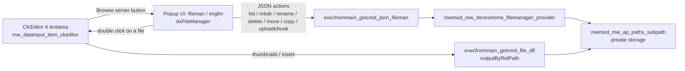

# HTML Editor and File Manager (CKEditor 4 + DevExtreme FileManager)

This guide documents how Meralda edits HTML content and lets the user pick files and images
from the server. It replaces the former CKFinder/KCFinder integration with a DevExtreme
`dxFileManager` backed by `mwmod_mw_devextreme_filemanager_provider`.

Working reference implementation (login required):

```
/admin/index.php?sui1=htmleditor&sui=ui&ui=demo
```

Source: `src/mwap/modules/mw/demo/ui/ui/htmleditor.php` and `.../htmleditor/`.

---

## Architecture



| Piece | Class / file | Role |
| --- | --- | --- |
| Editor input | `mw_datainput_item_ckeditor` (`res/js/inputs/ckeditor.js`) | Wraps a `<textarea>` and calls `CKEDITOR.replace(input, editorcfg)`. |
| Alternative input | `mw_datainput_item_tinymce` (`res/js/inputs/tinymce.js`) | Same wrapper over TinyMCE 6. See "TinyMCE 6" below. |
| Popup helper | `mw_file_picker` (`res/js/mw_file_picker.js`) | Opens the file manager popup and returns the picked file to any editor. |
| Legacy form input | `mw_input_elem_ckeditor` (`res/js/inputsman/ckeditor.js`), `mwmod_mw_datafield_ckeditor` | Same editor for the old `datafield` forms. |
| Browser popup | `mwmod_mw_demo_ui_ui_htmleditor_filemanager` | Subinterface that renders a `dxFileManager` and returns the selection to CKEditor. |
| Image-only popup | `mwmod_mw_demo_ui_ui_htmleditor_imgfm` | Same popup with `imageOnlyMode=true`. |
| JS provider | `MeraldaFileManagerHelper` (`res/js/mwdevextreme/filemanager.js`) | Builds a `DevExpress.fileManagement.CustomFileSystemProvider` that talks to the JSON endpoint. |
| PHP provider | `mwmod_mw_devextreme_filemanager_provider` | Implements the actions and the security rules. Returns arrays only; the UI does the JSON output. |
| Storage | `mwmod_mw_ap_paths_subpath` | Sandboxed path manager. Also serves files (`outputByRelPath`). |
| Extension rules | `mwmod_mw_helper_fileman` | Allowed / forbidden extensions, image extensions, secure file names. |

---

## Using it in a UI

The demo UI (`mwmod_mw_demo_ui_ui_htmleditor`) is the template. The parts that matter:

### 1. Storage and provider

```php
/** @return false|mwmod_mw_ap_paths_subpath */
function getFileProviderPathMan(){
    if(!$this->fileProviderPathMan){
        if(!$demoMan=$this->getDemoMan()){ return false; }
        // private (non public) sub path: files are only served through the dlf command
        $this->fileProviderPathMan=$demoMan->get_sub_path_man("htmleditorfiles",false);
    }
    return $this->fileProviderPathMan;
}

function createFileProvider(){
    if(!$pathMan=$this->getFileProviderPathMan()){ return false; }
    $fileProvider=new mwmod_mw_devextreme_filemanager_provider($pathMan);
    $fileProvider->downloadURL=$this->get_exec_cmd_file_url("dlf"); // used for thumbnails
    $fileProvider->setAllowAll();                                   // see "Permissions"
    return $fileProvider;
}
```

### 2. Endpoints (commands of the parent UI)

```php
// JSON actions for dxFileManager. ?mode=images restricts to images.
function execfrommain_getcmd_json_fileman($params=array(), $filename=false){
    if(!$this->is_allowed()){ return $this->json_output_data(["success"=>false,"msg"=>"Not allowed"]); }
    if(!$fileProvider=$this->getFileProvider()){ return $this->json_output_data(["success"=>false,"msg"=>"No file provider"]); }
    if($params["mode"]=="images"){ $fileProvider->setImagesOnlyMode(); }
    $res=$fileProvider->handle_request($_REQUEST["action"] ?? "");
    return $this->json_output_data($res);
}

// Serves a stored file: /<ui url>/dlf/<relative path>
function execfrommain_getcmd_file_dlf($params=array(), $filename=false){
    if(!$this->is_allowed()){ return $this->maininterface->outputMsgNotAllowed("Not allowed"); }
    if(!$pathMan=$this->getFileProviderPathMan()){ return $this->maininterface->outputMsgNotAllowed("Not allowed"); }
    $pathMan->outputByRelPath($filename);
}
```

Every real application MUST replace the demo `is_allowed()` with its own permission check.

### 3. Subinterfaces for the popups

```php
function allowcreatesubinterfacechildbycode(){ return true; }
function _do_create_subinterface_child_fileman($cod){ return new mwmod_mw_demo_ui_ui_htmleditor_filemanager($cod,$this); }
function _do_create_subinterface_child_imgfm($cod){   return new mwmod_mw_demo_ui_ui_htmleditor_imgfm($cod,$this); }
```

The popup classes ask their parent for `getFileProvider()`, `getFileProviderPathMan()`,
`get_exec_cmd_json_url("fileman")` and `get_exec_cmd_file_url("dlf")`, so they can be reused as-is
(or copied into a project module) as long as the parent UI exposes those.

### 4. The editor input and its configuration

```php
$frmjs=new mwmod_mw_jsobj_inputs_frmonpanel();
$gr=$frmjs->add_data_main_gr();
$input=$gr->add_new_child("html","mw_datainput_item_ckeditor");
$input->set_value($currentHtml);
$input->set_prop("lbl","HTML content");

// CKEditor 4 hooks: any editorcfg.* property is passed to CKEDITOR.replace()
$input->set_prop("editorcfg.filebrowserBrowseUrl",      $this->get_url_subinterface("fileman")); // files / links
$input->set_prop("editorcfg.filebrowserImageBrowseUrl", $this->get_url_subinterface("imgfm"));   // images
$input->set_prop("editorcfg.extraPlugins","placeholder");                                        // optional
```

The form value is read server side with `mwmod_mw_helper_inputvalidator_request`:

```php
$inputMan=new mwmod_mw_helper_inputvalidator_request("data");
if($inputMan->is_req_input_ok()){
    $html=$inputMan->getTextRawValue("html");
}
```

### 5. JS/CSS preparation

`prepare_js_and_css_mans()` in the demo shows the complete list. The pieces specific to this feature:

```php
$util=new mwmod_mw_devextreme_util();
$util->preapare_ui_webappjs($this);                 // DevExtreme + dxFileManager

$util=new mwmod_mw_html_manager_uipreparers_ui($this);
$util->addCKEditor();                               // CKEditor 4 script
...
$jsman->add_item_by_cod_def_path("inputs/ckeditor.js");
$jsman->add_item_by_cod_def_path("mw_placeholders.js");          // only with placeholders
$jsman->add_item_by_cod_def_path("mwdevextreme/filemanager.js"); // MeraldaFileManagerHelper
```

The popup UI must load the same list, because it also needs DevExtreme and `filemanager.js`.

---

## How the picker page returns the selection

One picker page serves every editor. `onSelectedFileOpened` of the `dxFileManager`
(double click / Enter on a file) builds the file URL as `downloadUrl + file.path` (the `dlf`
command) and then tries, **in this order**:

1. **CKEditor 4**: if `CKEditorFuncNum` is in the query string and the opener has `CKEDITOR`,
   it calls `window.opener.CKEDITOR.tools.callFunction(CKEditorFuncNum, fileUrl)` and closes.
   CKEditor opens that window itself, this project only answers it.
2. **Generic protocol** (`mw_file_picker`): tries `window.parent` and then `window.opener`
   and calls `mw_filepicker_receive(fileData, token)`, with
   `fileData = {url, path, name, isDirectory}` and `token = window.name`.
3. Otherwise it logs `El abridor no acepta archivos ...` and stays open.

The `token` is the browsing context name the helper assigned (the `iframe name` or the popup
window name), so several pickers can be open at the same time without mixing answers.

### Why an iframe modal and not a window

`mw_file_picker.open()` shows the picker in an **iframe inside a modal of the current page** by
default:

- popup blockers never interfere (a `window.open` from a dialog callback was measured being
  blocked, which is exactly the "cannot pick an image" symptom);
- it stays inside the admin look and feel, and above the editor dialogs (`z-index` 126000);
- the picker page is rendered in `layout-single-mode`, so it looks clean inside the frame;
- `window.parent` is same origin, so the answer is delivered directly.

`mode: "window"` still opens a real window (answered through `window.opener`), kept for callers
that need it.

Closing: the header `×`, the `Esc` key, or the reception of an answer. `document.body` scroll is
locked while open and restored when the last picker closes.

---

## Provider reference

`mwmod_mw_devextreme_filemanager_provider` (`src/mwap/modules/mw/devextreme/filemanager/provider.php`).

### Actions (`handle_request($action)`)

| Action | Permission flag | Notes |
| --- | --- | --- |
| `list` | always allowed | Hides names starting with `.`, forbidden extensions and, in image mode, non images. Images get a `thumbnail` when `downloadURL` is set. |
| `mkdir` | `allowCreate` | Name sanitized to `[A-Za-z0-9._-]`. |
| `rename` | `allowRename` | Extension validated by the `FileMan`. |
| `move`, `copy` | `allowMove`, `allowCopy` | Copy validates every file extension against the destination `FileMan`. |
| `delete` | `allowDelete` | Never the root. Non empty folders only when `allowRecursiveDelete` is on (off by default). |
| `uploadchunk`, `cancelUpload` | `allowUpload` / always | DevExtreme chunked upload (1 MB chunks). Chunks are assembled in `.__chunk_tmp_<id>`, validated and renamed to a URL secure file name. |
| `upload` | `allowUpload` | NOT implemented (it dies). The widget uses `uploadchunk`. |
| `download` | `allowDownload` | The real download is done by the UI through the `dlf` command. |

Responses are `["success"=>true, ...]` or `["success"=>false, "msg"=>"..."]`.
Messages are translatable with the `devext.filemanager.*` keys.

### Permissions

```php
$fileProvider->setAllowDefaults();           // create, delete, upload, download
$fileProvider->setAllowAll();                // + copy, move, rename
$fileProvider->setAllowRecursiveDelete(true);// explicit opt in
$fileProvider->setImagesOnlyMode();          // images only (list + allowedFileExtensions)
```

`setDxFileManagerProps($params)` copies the flags to the `permissions.*` options of the widget and
fills `allowedFileExtensions` (all allowed extensions, or only image extensions in image mode),
so the client and server rules stay aligned.

### Security rules enforced server side

- Every path goes through `norm_rel()` and `pathMan->check_sub_path()` (no traversal outside the storage).
- Names containing `..`, `/`, `\`, `:`, `*`, `?`, `"`, `<`, `>`, `|` or starting with `.` are not listed nor accepted.
- File extensions are validated with `mwmod_mw_helper_fileman::check_ext_from_filename()`; the allowed and forbidden lists live there.
- Uploaded file names are converted to a URL secure name.
- The provider never writes output. Permission checks on the UI (`is_allowed()`) are the caller's responsibility.

---

## Placeholders in the editor (optional)

`[[code]]` or `[[code {"json":"params"}]]` tokens are edited as widgets by the CKEditor `placeholder`
plugin (`res/thirdparty/ckeditor/plugins/placeholder`). The Meralda part (`mw_placeholders`,
`res/js/mw_placeholders.js`) adds a catalog and a modal form to choose the placeholder and its parameters:

```php
$input->set_prop("editorcfg.extraPlugins","placeholder");
$pholders=new mwmod_mw_jsobj_objcoladv_base("placeholderman","mw_placeholders");
$input->set_prop("editorcfg.mw.placeholderman",$pholders);

$ph=$pholders->add_new_child("customer.fullName");
$ph->set_prop("lbl","Customer full name");

// Placeholder with parameters
$ph=$pholders->add_new_child("order.summary");
$ph->set_prop("lbl","Order summary");
$inputs=new mwmod_mw_jsobj_inputs_input("inputs","mw_datainput_item_group");
$inputs->add_new_child("headline")->set_prop("lbl","Headline");
$ph->set_prop("inputs",$inputs);
```

Rendering is the application's job: replace the `[[...]]` tokens when the saved HTML is used.

---

## Known limitations and notes

- The provider header states "under construction"; review it before exposing it outside the admin.
- Inserted files and images get the URL built by `get_exec_cmd_file_url("dlf")` plus the relative path.
  That endpoint requires a logged in user, so content shown to the public needs either a
  public storage (`get_sub_path_man($sub, true)` with a public URL) or a rewrite of the URLs on output.
- `CKEditor` is loaded with `addCKEditor()` from `/res/ckeditor/ckeditor.js`. On Apache `res/ckeditor/.htaccess`
  redirects (301) to `/res/thirdparty/ckeditor/`; on nginx add the equivalent redirect or change the path
  in `mwmod_mw_html_manager_uipreparers_abs::addCKEditor()` to `/res/thirdparty/ckeditor/ckeditor.js`.
- The bundled CKEditor is **4.5.3 (2015)**, out of community support since 2023, licensed GPL/LGPL/MPL.
  See "TinyMCE 6" below for the maintained alternative.
- `res/js/mwckeditor/mw_ckeditor_placeholders.js` is an empty file and is not used.
- The old KCFinder integration (`mwmod_mw_kcfinder_*`, debug UI `others`/`kcfinder`) is still in the
  code base but is not used by the demo editor.
- Upload size is bound by PHP `upload_max_filesize` / `post_max_size`; chunking only avoids a single large request.

---

## TinyMCE 6 (self hosted, MIT)

A second engine for the same job. It reuses the whole file manager described above: only the
editor and the way the popup answers change.

### Version and license (important)

| TinyMCE | License |
| --- | --- |
| 5.x | LGPL 2.1 |
| **6.x** | **MIT** ← the one installed |
| 7.x / 8.x | GPL-2.0-or-later or commercial |

Meralda is MIT, so **6.8.6 is the last version that can be redistributed without changing the
project license**. Upgrading to 7/8 turns the distributed bundle into GPL (same situation as
CKEditor 5). Do not upgrade without an explicit licensing decision.

Installed at `src/public_html/res/thirdparty/tinymce/` (its own repo, not ignored by git):

```
tinymce.min.js        433 KB   the editor
themes/silver/                the only theme, required
skins/ui/oxide/, skins/content/
models/dom/
plugins/                      all community plugins (only the used ones are loaded)
langs/es.js, langs/es_MX.js   from tinymce-i18n (not shipped in the npm package)
license.txt, notices.txt      keep them: MIT requires the notice
```

`tinymce.js` (unminified, 4 MB) was intentionally not installed.

### Loading

```php
$util=new mwmod_mw_html_manager_uipreparers_ui($this);
$util->addTinyMCE();                             // tinymce.min.js + mw_file_picker.js
$util->preapare_ui();
$jsman->add_item_by_cod_def_path("inputs/tinymce.js");
$jsman->add_item_by_cod_def_path("mw_placeholders.js");        // only with placeholders
$jsman->add_item_by_cod_def_path("mwdevextreme/filemanager.js"); // only for the open-in-page manager
```

TinyMCE resolves skins, plugins and langs from the `<script src>` it was loaded with, so the
canonical `/res/thirdparty/tinymce/` path must be used — no rewrite in front of it.

### The input

`mw_datainput_item_tinymce` (`res/js/inputs/tinymce.js`) is a drop-in replacement of
`mw_datainput_item_ckeditor` in the new inputs API.

**Always build it through the PHP helper** (`mwmod_mw_jsobj_inputs_tinymce`), not with
`set_prop("...")`: the helper knows the exact property names the JS reads. See "PHP helper"
below.

```php
$jsinput=$gr->add_newTinyMCE("html","HTML content");
$jsinput->set_value($currentHtml);
$jsinput->setHeight(420);
$jsinput->setFilePickerUrls(
    $this->get_url_subinterface("fileman"),
    $this->get_url_subinterface("imgfm")
);
```

| Param | Meaning |
| --- | --- |
| `editorcfg` | object merged into `tinymce.init()`; a caller `setup` / `file_picker_callback` is chained, not replaced |
| `filemanurl` | popup used for links and files |
| `imagemanurl` | popup used for images (falls back to `filemanurl`) |
| `placeholderman` | `mw_placeholders` instance → adds the `[[ ]]` toolbar button |
| `lang` | TinyMCE language code, default `es` |
| `height` | editor height, default 300 |
| `validateonkeyup` | fire `on_change` on keyup, default false |

`editorcfg.filebrowserBrowseUrl` / `filebrowserImageBrowseUrl` are accepted as fallbacks, so a
form migrated from CKEditor keeps working.

## PHP helper

`mwmod_mw_jsobj_inputs_tinymce` → `src/mwap/modules/mw/jsobj/inputs/tinymce.php`.
It extends `mwmod_mw_jsobj_inputs_input`, so everything the other inputs offer (`setLabel`,
`setNotes`, `setRequired`, `setReadOnly`, `setDisabled`, `set_value`, `get_child`, …) is
inherited.

Create it with `addNewTinyMCE()` on any input or group:

```php
$jsgr   = $frmjs->add_data_main_gr();
$editor = $jsgr->addNewTinyMCE("html","HTML content");   // label is optional
```

### Setters (fluent)

| Method | Effect |
| --- | --- |
| `setHeight($px)` | Editor height. |
| `setLang($code)` | TinyMCE language; a file must exist in `res/thirdparty/tinymce/langs/`. |
| `setValidateOnKeyUp($bool)` | Fire `on_change` on each key press. |
| `setFileManUrl($url)` | Picker used by the link dialog and generic file insert. |
| `setImageManUrl($url)` | Picker used by the image dialog. |
| `setFilePickerUrls($fileUrl,$imageUrl=false)` | Sets both; images default to `$fileUrl`. |
| `setPlugins($arrayOrString)` | Replaces the plugin list. |
| `addPlugins($arrayOrString)` | Appends plugins, skipping duplicates. |
| `setToolbar($arrayOrString)` | Replaces the toolbar (array is joined with spaces). |
| `addToolbarItems($arrayOrString)` | Appends a group to the current toolbar. |
| `setMenuBar($bool)` | The JS default is `false`; kept to turn it back on. |
| `setEditorCfg($key,$val)` | Any `tinymce.init()` option; dot notation builds nested objects. |
| `setContentCss($url)` | Shortcut for `content_css`. |
| `setSchema($mode)` | `html`, `xhtml` or `html5`. |

### Placeholders

```php
// Simple
$editor->addPlaceholder("customer.fullName","Customer full name");

// With parameters: returns the params group
$params = $editor->addPlaceholderWithParams("customer.address","Customer address");
$params->add_new_child("addressLine1")->set_prop("lbl","Street");
$grp = $params->add_data_gr("addressExtra");
$grp->add_new_child("city")->set_prop("lbl","City");
$grp->add_new_child("postalCode")->set_prop("lbl","Postal code");

// Toolbar button label
$editor->setPlaceholdersButtonLabel($this->lng_get_msg_txt("insertPlaceholder","Insertar marcador"));
```

The catalog is created lazily by the first `addPlaceholder()`. To share one catalog between
several editors, build it once and pass it:

```php
$cat = $editorA->setPlaceholders();          // creates and returns the catalog
$editorB->setPlaceholders($cat);             // same catalog
```

### Array values render as JS arrays

Any PHP **0-based sequential** array passed as a property renders as a JavaScript array
(`['a','b']`). Associative arrays render as object literals. This is what makes
`setPlugins(array("lists","link"))` produce a real array for TinyMCE.

> Prior to this work the serializer had `$isassoc` initialised to `true` and a `if($cod)` guard
> on the object path, so a PHP list rendered as `{1:'b'}` — **the first element was silently
> dropped**. Fixed in `mwmod_mw_jsobj_obj::get_as_js_val_from_array()`.

Behaviour worth knowing:

- `get_input_value()` reads `editor.getContent()`.
- **The original `<textarea>` is NOT updated by TinyMCE.** A plain form submit would send the
  old value. `syncInputElem()` copies the content into it, and `attachFormSync()` adds one
  `submit` listener per form in the **capture phase**, so the textarea is valid before
  `onsubmit` and before anything reads `FormData`. Without this the demo saved empty content.
- `set_input_value()` writes both the editor and the textarea, which is what TinyMCE
  restores/destroys against.
- The `<textarea>` id is made unique (`<name>_tinymce_<n>`) because TinyMCE refuses an id that
  already exists on the page.
- `setReadOnly()` / `setDisabled()` switch `editor.mode` to `readonly`.
- `append2hiddenFrm()` still works for the non-form data path.
- `destroy()` removes the TinyMCE instance from its registry. Call it before discarding a
  container that holds an editor, otherwise the instance leaks.

Defaults applied (each one overridable through `editorcfg`):

| Option | Default | Why |
| --- | --- | --- |
| `menubar` | `false` | The File/Edit/View... menu duplicates the toolbar. |
| `toolbar_mode` | `"wrap"` | Without it the last buttons (image among them) hide behind the `»` overflow. |
| `convert_urls` | `false` | TinyMCE rewrites `src`/`href` to `../get/...`, which breaks the saved HTML on other pages. |
| `relative_urls` | `false` | Same. |
| `remove_script_host` | `false` | Same. |
| `promotion` | `false` | Hides the "Upgrade" button of the community build. |

Measured: the toolbar renders all 20 buttons in one wrapped block, the image button included.

### The popup protocol

One picker page serves both engines: `mw_file_picker` delivers the file to any editor. See
"How the picker page returns the selection" above for the delivery order and rationale.

The TinyMCE input reaches the picker through `file_picker_callback`, so the image dialog fills
`src` + `alt` and the link dialog fills `href` + `title`:

```js
mw_file_picker.open({url: "/admin/index.php?...&cmd=json_fileman"}, function (data) {
    // data = {url, path, name, isDirectory}
});
```

The picker page no longer loads CKEditor: it only hosts the file manager, and the
`CKEDITOR.tools.callFunction` branch runs on the **opener**, which is the page that has CKEditor.
Removing `addCKEditor()` and `inputs/ckeditor.js` from the popup took ~500 KB off the picker and
keeps the CKEditor dependency out of the TinyMCE flow.

### Placeholders

The CKEditor integration patches the placeholder plugin dialog. TinyMCE has no such plugin, so the
placeholders become a **toolbar button** that calls the same `mw_placeholders` modal:

```php
$pholders=new mwmod_mw_jsobj_objcoladv_base("placeholderman","mw_placeholders");
$jsinput->set_prop("placeholderman",$pholders);
$ph=$pholders->add_new_child("order.number");
$ph->set_prop("lbl","Order number");
```

The catalog and the params form are identical to the CKEditor version (same `inputs` sub-object).
On accept, `mw_placeholders` calls `insertText()` on the input, which runs
`editor.insertContent(editor.dom.encode(token))` — the token is inserted as **text**, so
`[[customer.address]]` is never interpreted as HTML and can carry `&` or `<`.

### Demo and tests

- Demo page: `/admin/index.php?sui1=tinymceeditor&sui=ui&ui=demo`
  (`mwmod_mw_demo_ui_ui_tinymceeditor` extends the CKEditor demo, so it inherits the provider,
  the JSON commands and the `fileman` / `imgfm` popups; the storage is the same). It builds the
  editor entirely through the PHP helper and doubles as usage example.
- JS smoke test: `node docs/tools/_test/mw_tinymce_smoke.js <path to res/js>` — 81 checks with a
  stubbed DOM and a stubbed `tinymce`, covering option merging and defaults, value round trip,
  textarea sync and form submit, read only, placeholders, both picker modes, the iframe modal and
  the delivery protocol.
- PHP smoke test: `php docs/tools/_test/jsobj_tinymce_helper.php` — 49 checks on the helper
  (autoload, every setter, plugin merging, placeholder catalog, sharing, and the array
  serialization cases).
- Verified manually in the browser: image picked from the file manager lands in the image dialog
  (`src` + `alt`) and the URL is stored absolute; the link dialog gets `href` + `title`; `Esc`
  closes the modal and restores the scroll; the content saved through the form survives a reload;
  the placeholder modal lists the catalog built by the helper and renders its parameter form; the
  CKEditor demo page still initializes with the lighter picker page; the users grid and the inputs
  demo render without console errors after the serializer change.

## Open issues found while wiring this up

- `cleanup_chunk_reldir()` leaves the `.__chunk_tmp_<id>` folders behind on disk (one was found
  next to a completed upload). They are hidden from `list` because the name starts with `.`, so
  the user never sees them, but they accumulate.
- `cmd_upload_chunk()` uses `$_REQUEST["uploadId"]` verbatim when building
  `$destAbs . "/.__chunk_tmp_" . $uploadId` and calls `mkdir(..., true)` on it. That value is not
  sanitized, so it should be constrained (for example to `[A-Za-z0-9_]`) before it reaches the
  filesystem.
- The image dialog's browse button is labelled "Browse files" in English: TinyMCE hardcodes it
  as `picker_text` in `plugins/image/plugin.min.js`, so it is not a translation key and cannot be
  fixed from `langs/es.js`. Replacing it requires a custom dialog or patching the plugin.


---

## Checklist to add an HTML editor with file browsing to a module

1. Create (or reuse) a private storage with `get_sub_path_man("<folder>", false)`.
2. Add `getFileProviderPathMan()`, `createFileProvider()`, `getFileProvider()` to the UI.
3. Add the `json_fileman` and `file_dlf` commands with a real `is_allowed()` check.
4. Add the `fileman` and `imgfm` subinterfaces (copy the demo classes).
5. Add a `mw_datainput_item_ckeditor` input and set `editorcfg.filebrowserBrowseUrl` / `filebrowserImageBrowseUrl`.
6. Load the JS list of `prepare_js_and_css_mans()` in the main UI and in the popup UIs.
7. Decide how the stored file URLs will be resolved for public output.
